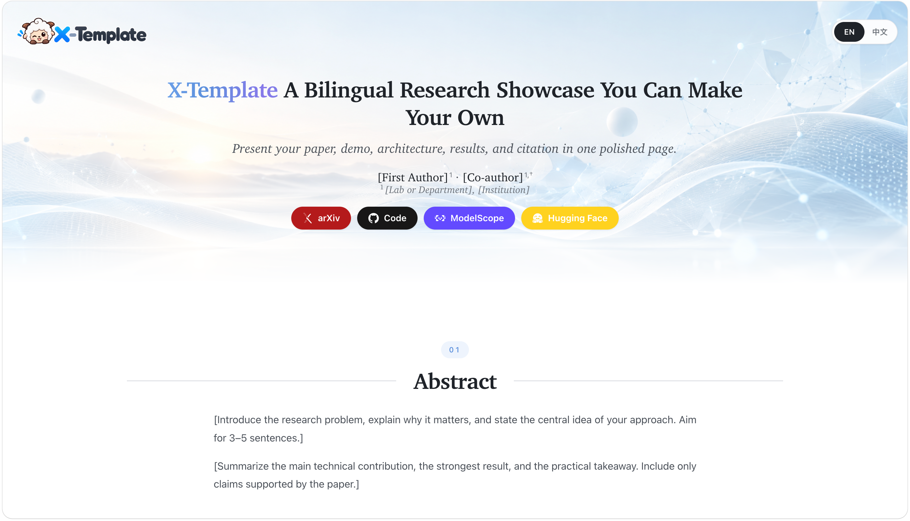
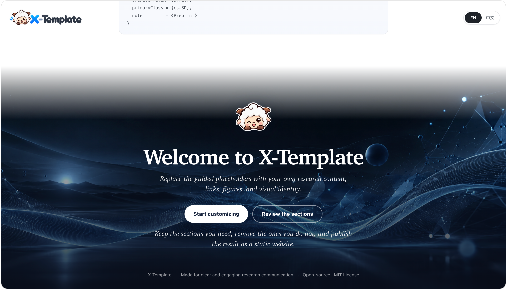

  

  A bilingual, responsive, single-page template for academic projects and research papers.

X-Template provides a polished starting point for presenting a paper, research
system, or project. Guided placeholders explain what to add to each section,
while the layout, responsive behavior, and bilingual interface are ready to use.

## Features

- English and Chinese language switching
- Responsive desktop and mobile layouts
- Guided placeholders for every content section
- Paper, code, ModelScope, and Hugging Face links
- Optional Bilibili video embedding
- Architecture image and evaluation table sections
- Copyable BibTeX citation
- No framework or build step required

## Customize

1. Replace the bracketed placeholder content in `index.html`.
2. Update the matching English and Chinese text in `assets/page/page.js`.
3. Replace links marked with the `data-placeholder` attribute.
4. Add a Bilibili video ID to `data-bvid=""`, or adapt the embed for another provider.
5. Update `citationkeyYEAR`, `XXXX.XXXXX`, and the other BibTeX fields.
6. Change the accent colors near the top of `assets/page/template.css` if needed.

Replace the following files in `assets/images/` to apply your own visual identity:

- `logo.png` — navigation logo
- `logo-small.png` — closing-section mark
- `favicon.png` — browser icon
- `hero-background.jpg` — opening background
- `cta-background.jpg` — closing background
- `architecture-placeholder.png` — system architecture figure
- `og-card.png` — social sharing image

## Page Demo

  

  

## License

Released under the [MIT License](./LICENSE).
